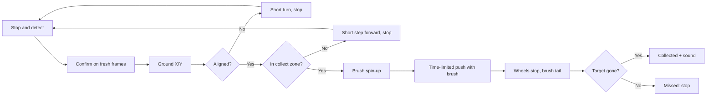

# METALSWEEP

A small robot car that finds metal debris on the floor, drives to it and sweeps it into its scoop.

It runs on a **Raspberry Pi 4B** with one **OV5647 camera**, an **L298N** for the left and right wheels, and a **CCM6N** brush board switched by a relay. A single-class YOLO11n model (`debris`) runs on the Pi as NCNN; on the car it detects brass tubes at about 0.9 confidence on light floors.

This repository holds the software, print models, wiring and assembly material. Training/labelling tools and time-limited closed-loop control are implemented and tested on the car (detection, calibration, tracking and the final push). **No trained field model is included, and there is no accuracy promise.**

## Start here

1. [Quick start](docs/QUICKSTART.md): label and train on the Mac; collect, detect and drive on the Pi.
2. [Measurements](docs/MEASUREMENTS.md): distance mapping, step distance, turning and collection trials.
3. [Hardware and wiring](docs/HARDWARE.md): L298N wheels, CCM6N + relay brush, power.
4. [Data plan and COCO import](docs/DATA.md): what to photograph, batches of 50, TACO filters.
5. [Status](docs/STATUS.md): what is software-tested, mesh-checked or verified on the car.

## Contents

| Folder | Contents | Status |
|---|---|---|
| [software/debris-training](software/debris-training) | Mac studio: capture, box labelling, cumulative YOLO training, evaluation, NCNN export, COCO import | Current training tool |
| [software/debris-collector](software/debris-collector) | Pi photo collector: sorted by scene/split, progress, ZIP export for the studio | Separate from training; standard library only |
| [software/metalsweep-control](software/metalsweep-control) | CSI camera, detection, ground mapping, time-limited wheel and brush control, Auto nearest / all in view, sounds | Simulation by default; GPIO only after verification |
| [hardware/cad-v8](hardware/cad-v8) | Current model: camera holder (post/bar/front), brush shaft, cleaning wheel, ramp, storage box; 7 STL files | Mesh-checked; box/ramp/shaft test-fitted |
| [hardware/camera-slot-mount](hardware/camera-slot-mount) | Camera slot mount on the main post, 30° down; parametric generator | Board size 25×24 mm by default, to be measured |
| [hardware/wiring](hardware/wiring) | Pi 4B / L298N wiring on official photos, and its generator | Check voltages and jumpers on the real parts |
| [docs/poster](docs/poster) | System flow diagram for the poster | — |

## How the car collects

The camera is fixed and calibrated to the floor plane. A target leaving the image does not prove it entered the box. There is no table-edge, collision or stall sensing, so test on a floor with barriers. A software timeout does not replace a physical power switch.

## Current model

The print files are in [hardware/cad-v8](hardware/cad-v8). The storage box sits under the front of the chassis, the ramp joins its front edge, and the brush shaft, driven directly by a gear motor, sweeps debris up the ramp into the box.

Older chassis, mounts and demos were removed from the repository; they remain in the git history.

## Files and sources

Virtual environments, collected photos, trained weights, runtime caches, personal network addresses, passwords and third-party datasets are not uploaded. The release file checksums are in [publication-manifest.json](docs/publication-manifest.json); check them with `python tools/check_repository.py`.

External images, datasets, dependencies and references are listed in [ASSET_SOURCES.md](docs/ASSET_SOURCES.md). No licence has been chosen for third-party content or the project code.
