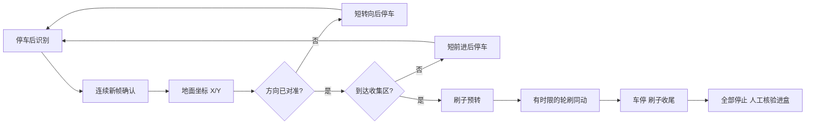
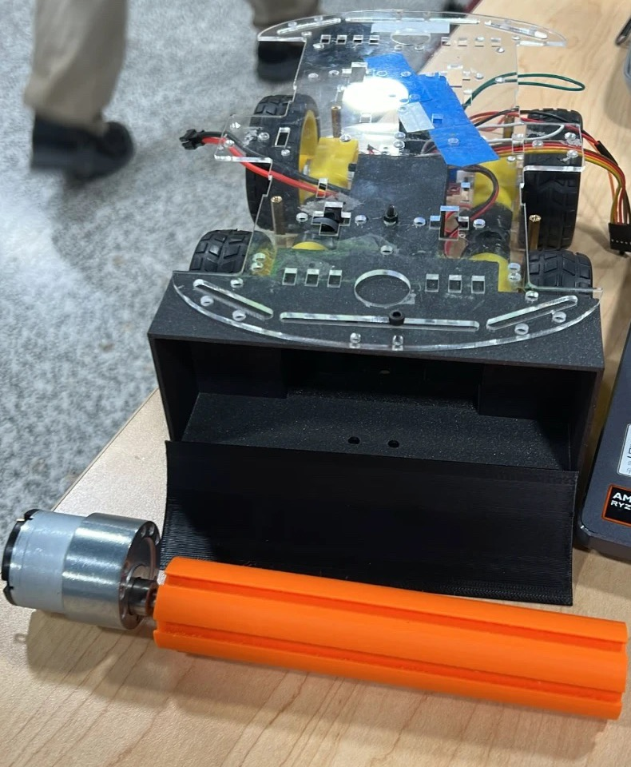

# METALSWEEP

桌面碎片收集机器人原型 / Desktop debris collection robot prototype

使用 **Raspberry Pi 4B + OV5647 单摄像头 + L298N 左右轮控制 + CCM6N 滚刷调速板**，目标为**成团纸屑与瓶盖**。第一版视觉模型统一使用 `debris` 一个类别。

本仓库整理现有软件、打印模型、接线与装配资料。已实现训练/标注工具和有时限的联动控制代码；**尚未完成实车自主收集验收，不包含已训练好的现场模型或准确率承诺**。

## 从这里开始

1. [运行与训练流程](docs/QUICKSTART.md)：Mac标注/训练，Pi采集/推理/控制。
2. [待测尺寸与控制参数](docs/MEASUREMENTS.md)：距离映射、前进位移、转向和进盒试验。
3. [硬件与驱动边界](docs/HARDWARE.md)：L298N车轮、CCM6N加继电器开关方案。
4. [数据采集与COCO转换](docs/DATA.md)：纸团/瓶盖、50张迭代、TACO筛选。
5. [版本及验证状态](docs/STATUS.md)：区分软件测试、网格检查与实物验证。

## 目录

| 位置 | 内容 | 使用状态 |
|---|---|---|
| [software/debris-training](software/debris-training) | Mac网页采集、框标注、累计YOLO训练、评估、NCNN导出、COCO导入 | 当前训练工具 |
| [software/metalsweep-control](software/metalsweep-control) | CSI图像、目标检测、地面映射、左右轮与刷子有时限控制 | 默认模拟，核验后才启用GPIO |
| [software/debris-detector-pi4](software/debris-detector-pi4) | 颜色/静态背景检测网页、原图接口 | 独立诊断工具；背景法要求车/光照固定 |
| [hardware/cad-v8](hardware/cad-v8) | 当前模型：摄像头支架（竖杆/横杆/前部件）、滚刷主轴、清扫轮、斜坡、收集盒，共7个STL | 网格已检查，尚未打印试装 |
| [hardware/camera-slot-mount](hardware/camera-slot-mount) | 摄像头插槽支架：电路板从上插入，套在主柱子顶端，30°俯角；参数化生成脚本 | 板尺寸按25×24mm默认，待实物测量 |
| [hardware/wiring](hardware/wiring) | Pi4B/L298N官方原图接线图与排版源码 | 电压/跳帽按实物核对 |
| [docs/camera-orientation](docs/camera-orientation) | 摄像头朝向概念图 | 概念参考 |
| [archive](archive) | 较早版本的底盘、支架（含V7支架、V3刷子件）、装配图与算法演示 | 历史参考，不混装不同版本零件 |
| [extras](extras) | 独立卷纸盒、粘贴式卷纸支架 | 与机器人分开的附加项目 |

## 当前联动设计

当前采用固定相机和平面标定。目标消失不等于已进盒；没有桌沿/碰撞/堵转感知，实物运动测试先使用有围挡的地面。软件超时关闭输出不能代替实体电源开关。

## 当前模型

打印文件见 [hardware/cad-v8](hardware/cad-v8)：收集盒装在底盘前端下方，斜坡接在盒前缘，滚刷主轴由减速电机直接驱动，把碎片扫上斜坡进盒。

此前的V7摄像头支架与V3刷子件已移至 [archive/camera-mount-v7](archive/camera-mount-v7) 和 [archive/brush-collector-v3](archive/brush-collector-v3)，不与V8零件混装。尺寸确认状态见[尺寸记录](docs/MEASUREMENTS.md)。

## 文件与来源

不上传虚拟环境、采集照片、训练权重、运行缓存、个人网络地址、密码或第三方数据集。源文件清单见 [source-files.json](docs/source-files.json)，最终发布文件校验见 [publication-manifest.json](docs/publication-manifest.json)。重复ZIP和可重新生成的10MB装配SVG未重复纳入。

外部图像、数据集、依赖与参考资料见 [ASSET_SOURCES.md](docs/ASSET_SOURCES.md)。本次整理没有为第三方内容或项目代码重新指定许可证。
