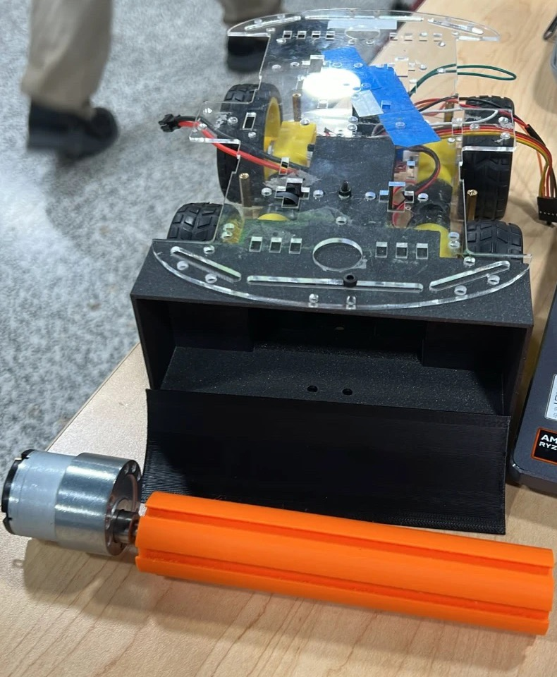

# CAD v8

Current print model (updated 2026-11-05). It replaces the earlier camera-mount-v7 and brush-collector-v3 parts, which are no longer in the repository (see git history).

| File | Part | Size X×Y×Z (mm) |
|---|---|---|
| [camera-holder-vertical.stl](camera-holder-vertical.stl) | Camera holder · vertical post | 10 × 100 × 10 |
| [camera-holder-horizontal.stl](camera-holder-horizontal.stl) | Camera holder · horizontal bar | 4.5 × 7 × 80 |
| [camera-holder-front.stl](camera-holder-front.stl) | Camera holder · front part | 30 × 42 × 30 |
| [shaft-main.stl](shaft-main.stl) | Brush shaft (with a lengthwise slot, driven directly by the gear motor) | 29.7 × 145 × 30 |
| [cleaning-wheel.stl](cleaning-wheel.stl) | Cleaning wheel blade (fits on the shaft; not fitted in the photo) | 7.6 × 145 × 28.1 |
| [ramp-main.stl](ramp-main.stl) | Ramp (front edge of the storage box) | 67.5 × 149 × 31.1 |
| [metal-storage-main.stl](metal-storage-main.stl) | Metal storage box (under the front of the chassis) | 149 × 60 × 118 |

## Assembly

Rough layout (the photo is a table-top test fit, not the final mounting):

1. The storage box sits under the front of the acrylic chassis, opening forward.
2. The ramp joins the front edge of the box and slopes forward down to the floor.
3. The brush shaft lies across the front of the ramp. One end connects straight to the metal gear motor's output shaft; turning sweeps debris up the ramp into the box.
4. The camera holder (post + bar + front part) is not fitted in the photo; its position is still open.

The motor, the bearing/support for the other end of the brush, and the fixing screws are not in the STL files; confirm them on the real parts.

## Check status

- All 7 files are binary STL; file length matches the triangle count, and the meshes are closed (no non-manifold edges).
- The box, ramp and brush shaft are printed and test-fitted against the chassis. Fixing, powered rotation and real collection tests are not done yet.
- No source or parameter files; changes go back to the original CAD project.
